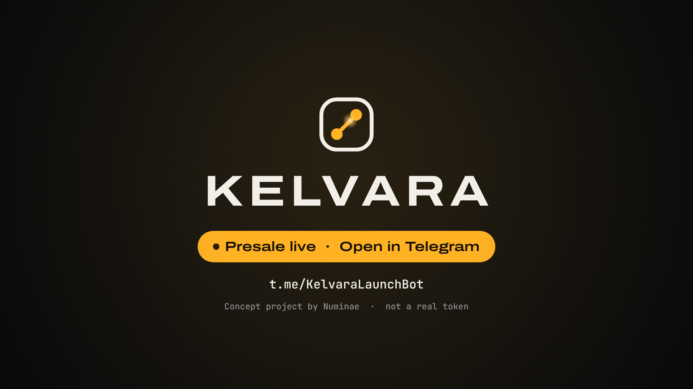

# Kelvara launch kit

**Kelvara is a concept project by [Numinae](https://github.com/NUMINAE).** It shows what a Web3 team gets for a token launch: a landing page, a Telegram Mini App and a launch ad. It is not a real token or network. Nothing is for sale, every figure is simulated, and the Mini App runs on TON testnet only.

The made-up project: **Kelvara (KVRA)**, a settlement network where robots, vehicles and AI agents pay each other in USDT, in under a second.

<a href="https://numinae.github.io/kelvara-launch-kit/"></a>

**[Live site](https://numinae.github.io/kelvara-launch-kit/)** · **[Mini App demo](https://numinae.github.io/kelvara-launch-kit/app/)** · **[Open in Telegram](https://t.me/KelvaraLaunchBot/app)** · **[Launch ad 16:9](ad/kelvara-launch-ad-16x9.mp4)** · **[Launch ad 9:16](ad/kelvara-launch-ad-9x16.mp4)**

## 1. Landing page

`index.html`

- 3D hero in three.js: a lattice of machines with payments running along its edges. It turns with the cursor and drifts back as you scroll.
- Live-looking launch figures: amount raised, participants, settlements and a countdown to the token launch.
- A live settlement feed, cards that tilt under the cursor, a "how it works" diagram that follows the scroll, an animated token allocation and a roadmap.
- No framework, no tracking, self-hosted fonts (Archivo, JetBrains Mono).

## 2. Telegram Mini App

`app/`, bot [@KelvaraLaunchBot](https://t.me/KelvaraLaunchBot)

The flow: connect a wallet, get test USDT, pay, then claim KVRA, with a receipt at each step. There are also screens for your allocation, activity, a staking preview and invites.

- **Demo mode** (the default) needs no wallet. Anyone opening the link can tap through the whole flow. Nothing leaves the screen.
- **Testnet mode** connects a real TON wallet with TON Connect and sends real testnet transactions. Mainnet wallets are refused. It has not yet been tried end to end with a live wallet.
- Inside Telegram it uses Telegram's back button and haptics. In a desktop browser it shows in a phone frame.

### The testnet contracts

`contracts/kelvara.tact` (Tact):

| Contract | What it does |
|---|---|
| `TestUsdt` | A faucet token, tUSDT (6 decimals). Anyone can mint up to 1,000 per tap. It stands in for USDT, which has no official TON testnet version. |
| `KelvaraSale` | The KVRA token and the presale in one. Records a KVRA allocation when tUSDT arrives (0.08 tUSDT per KVRA) and mints it when the buyer claims. |
| `JettonWallet` | The standard per-holder token wallet, used by both tokens. |

The first faucet tap and the first payment carry the contracts' code, so nothing needs deploying by hand. **These contracts are for testnet only and are not audited.**

`tests/flow.test.ts` sends the exact messages the Mini App builds to a local TON emulator, and checks:

- the full pay-then-claim flow
- a second claim is refused
- claiming without paying is refused
- the faucet cap holds
- a forged payment notice is refused
- overpaying moves nothing

## 3. Launch ad

`ad/`. 36 seconds, 1920×1080 and 1080×1920, 60 fps, with its own score and sound effects.

1. The lattice wakes up under "Machines pay machines." and the camera dives into an amber node.
2. That node becomes a drone's charging ring, then whip pans to a charger and a delivery robot, each with a live payment tag.
3. The real Mini App on a 3D phone: pay 250 tUSDT, then claim 3,125 KVRA, with every tap on the beat.
4. The launch figures, then the logo and "Presale live · Open in Telegram".

Every frame is drawn in code (`ad/film/film.js`, a pure function of time) with the same toolkit as the [Numinae ads](https://github.com/NUMINAE/numinae-motion/tree/main/ads). The machine shots are Flux 2 stills made in ComfyUI. The phone shows frames captured from the real Mini App. The score is synthesized at 120 bpm (`ad/film/audio/score.py`) and mastered to -14 LUFS.

## Files

```
index.html, assets/        landing page (assets/site.js is built from src/site/)
app/                       Mini App (app/app.js is built from src/app/), TON Connect manifest, token metadata
src/site/, src/app/        source for both
contracts/                 Tact contracts and their compiled output
tests/flow.test.ts         the pay-then-claim flow on a local TON emulator
ad/                        the launch ad (both formats, posters) and its source in ad/film/
style-samples/             the four style directions explored before the build
```

## Build and test

```
npm install
npm run build        # bundles assets/site.js and app/app.js
npm test             # runs the testnet flow on the emulator
npm run contracts    # recompiles the Tact contracts
```

---

Concept, design and code by [Numinae](https://github.com/NUMINAE). Questions: [@numinaestudio](https://t.me/numinaestudio) on Telegram.
